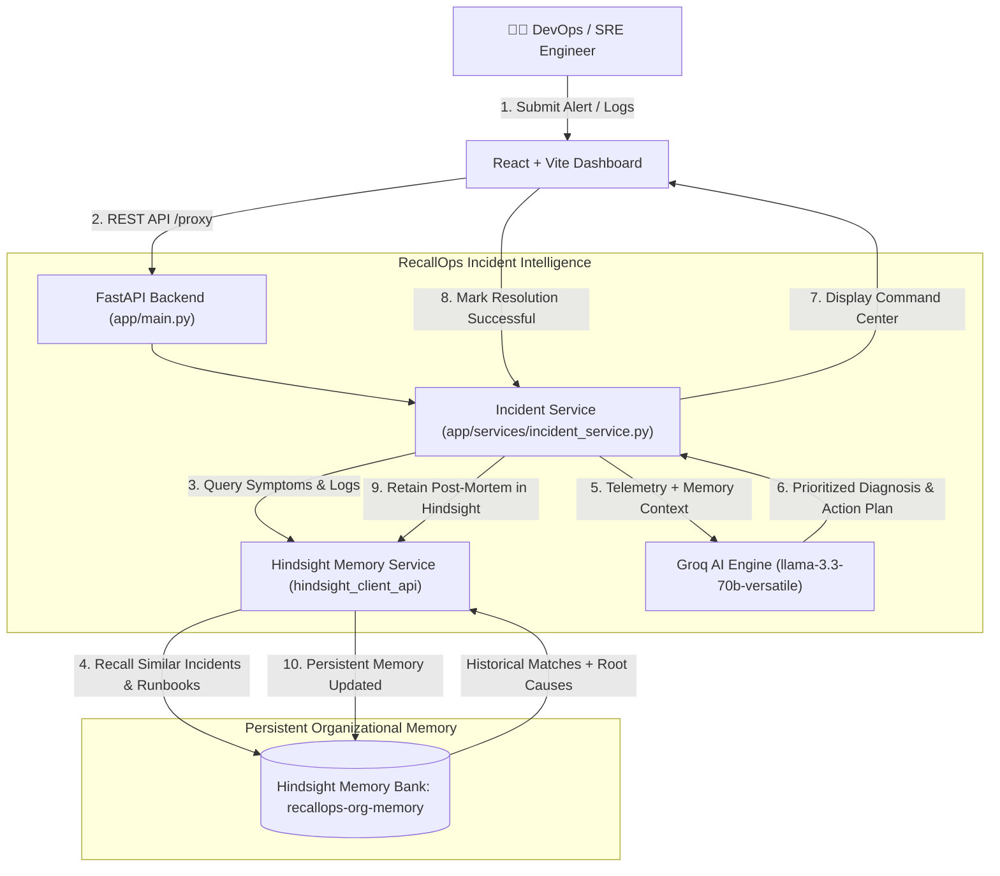

# RecallOps AI

> **"Your AI Incident Response Engineer that never forgets."**

[](https://github.com/)
[](https://github.com/vectorize-io/hindsight)
[](https://fastapi.tiangolo.com/)
[](https://vitejs.dev/)
[](https://console.groq.com/)

---

## 1. Problem Statement
When production goes down at 3:00 AM, on-call DevOps and SRE engineers waste critical minutes:
- Searching fragmented Slack channels and outdated Jira tickets.
- Reading through stale post-mortems and disconnected Confluence runbooks.
- Asking teammates: *"Didn't this happen to the payment-api during last quarter's flash sale?"*
- Repeating previously failed troubleshooting steps and unclosed socket checks.
- Rediscovering the exact same root causes and fixes from scratch.

A standard LLM chatbot gives generic answers (`"Check database connection pool, check network"`). **It starts from zero every single time.**

---

## 2. Solution: RecallOps AI
**RecallOps AI REMEMBERS.**

RecallOps is an AI Incident Response Agent with a persistent organizational memory bank powered by **Hindsight**. 

Instead of treating every alert as a cold start, RecallOps:
1. Ingests raw alerts, stack traces, and error logs.
2. Queries the persistent **Hindsight Memory Bank** (`recallops-org-memory`).
3. Recalls identical and related historical incidents, symptoms, and previous successful fixes.
4. Synthesizes a prioritized diagnosis and numbered remediation plan.
5. Captures the engineer's resolution after recovery and **stores the new learning directly in Hindsight**.
6. Continuously accelerates recovery time (MTTR) as the organization handles more incidents.

---

## 3. Why Persistent Memory Matters
```
WITHOUT MEMORY (Generic AI)     →   Answers from scratch. Generic troubleshooting. MTTR: ~28 minutes.
WITH HINDSIGHT (RecallOps AI)   →   Recalls past organization fixes. MTTR: ~11 minutes (2.2x faster).
```

> **The Core Differentiator:**  
> *"A generic AI knows what a database connection pool is.  
> RecallOps knows what **THIS** organization did the **LAST TIME** this happened."*

---

## 4. Architecture Diagram



---

## 5. Technology Stack
- **Frontend**: React 19, Vite, Lucide Icons, Vanilla CSS Design System with dark DevOps aesthetics.
- **Backend**: Python 3.11+, FastAPI, Uvicorn, Pydantic v2, HTTPX.
- **Persistent Memory**: Official [Hindsight Client SDK](https://github.com/vectorize-io/hindsight) (`hindsight-client` / `hindsight_client_api`).
- **AI Reasoning**: [Groq API](https://console.groq.com/) using `llama-3.3-70b-versatile` (with deterministic SRE fallback reasoning engine).

---

## 6. Official Hindsight Integration

RecallOps uses the official Hindsight SDK (`hindsight_client_api`) through a dedicated service abstraction in [`backend/app/services/hindsight_service.py`](file:///c:/Users/Admin/Desktop/HWH/backend/app/services/hindsight_service.py):

- **Memory Bank**: Isolated memory container (`recallops-org-memory`).
- **`retain` (`MemoryApi.retain_memories`)**: Stores incident post-mortems, verified fixes, symptoms, and service metadata after resolution.
- **`recall` (`MemoryApi.recall_memories`)**: Recalls semantic and keyword-matched incidents given new incoming alerts and error logs.
- **`reflect` (`MemoryApi.reflect`)**: Synthesizes cross-incident failure patterns and organizational success rates.
- **Graceful Fallback Mode**: If a live Hindsight server is not reachable locally during evaluation, the app automatically transitions to demo fallback mode with transparent UI labeling (`Hindsight memory running in fallback demo mode`).

---

## 7. Application Structure
```
HWH/
├── frontend/
│   ├── src/
│   │   ├── components/
│   │   │   ├── Header.jsx              # Status pills: AI Agent, Hindsight Status, Demo Launcher
│   │   │   ├── Navigation.jsx          # Tab navigation across all 7 views
│   │   │   ├── ResolutionModal.jsx     # Post-incident resolution & Hindsight retain form
│   │   │   └── DemoModal.jsx           # Guided 3-scene hackathon demo presentation
│   │   ├── pages/
│   │   │   ├── DashboardPage.jsx       # Active incident hero card & investigation timeline
│   │   │   ├── NewIncidentPage.jsx     # Incident submission with 1-click templates
│   │   │   ├── IncidentAnalysisPage.jsx# Incident Command Center (The centerpiece)
│   │   │   ├── MemoryPage.jsx          # Organizational memory explorer & search
│   │   │   ├── IncidentHistoryPage.jsx # Full historical incident table (12+ records)
│   │   │   ├── RunbooksPage.jsx        # Playbooks synthesized from memories
│   │   │   └── AnalyticsPage.jsx       # MTTR reduction charts & benchmark analytics
│   │   ├── services/
│   │   │   └── api.js                  # Centralized backend client
│   │   ├── index.css                   # Custom dark DevOps design system
│   │   └── App.jsx                     # Application state coordinator
│   ├── package.json
│   └── vite.config.js                  # Proxy configuration to FastAPI port 8000
│
├── backend/
│   ├── app/
│   │   ├── main.py                     # FastAPI application entry point
│   │   ├── models/
│   │   │   └── incident.py             # Pydantic data schemas
│   │   ├── services/
│   │   │   ├── hindsight_service.py    # Official Hindsight SDK integration
│   │   │   ├── llm_service.py          # Groq LLM client & fallback reasoning
│   │   │   └── incident_service.py     # Incident lifecycle coordinator
│   │   ├── routes/
│   │   │   ├── incidents.py            # Investigation and resolution endpoints
│   │   │   ├── memory.py               # Memory search and runbooks API
│   │   │   ├── analytics.py            # MTTR reduction telemetry
│   │   │   └── demo.py                 # Guided demo scenario payloads
│   │   └── data/
│   │       └── seed_data.py            # Realistic synthetic SRE incident dataset
│   ├── requirements.txt
│   ├── .env.example
│   └── .env
│
├── README.md
└── .gitignore
```

---

## 8. Setup & Installation

### Prerequisites
- Python 3.10+
- Node.js 18+ and npm

### Step 1: Clone and Configure Environment
```bash
# Clone the repository
git clone https://github.com/your-org/recallops-ai.git
cd HWH

# Configure backend environment variables
cp backend/.env.example backend/.env
```

Edit `backend/.env`:
```ini
# Groq LLM Configuration (Optional - fallback reasoning works without key)
GROQ_API_KEY=your_groq_api_key_here
GROQ_MODEL=llama-3.3-70b-versatile

# Hindsight Persistent Memory Configuration
# For local Hindsight server: http://localhost:8888 or Hindsight Cloud URL
HINDSIGHT_URL=http://localhost:8888
HINDSIGHT_API_KEY=your_hindsight_api_key_if_cloud
HINDSIGHT_BANK_ID=recallops-org-memory
```

---

## 9. Running the Application

### Option A: Run Backend (Terminal 1)
```bash
cd backend
python -m pip install -r requirements.txt
python -m uvicorn app.main:app --port 8000 --reload
```
The FastAPI backend will start at: `http://localhost:8000`  
Swagger API Documentation: `http://localhost:8000/docs`

### Option B: Run Frontend (Terminal 2)
```bash
cd frontend
npm install
npm run dev
```
The React frontend dashboard will start at: `http://localhost:5173`

---

## 10. The 3-Minute Hackathon Demo Script

Click the **"Run Memory Demo"** button in the top navigation bar to launch the guided presentation:

### Scene 1: First Incident (Cold Start)
- **Problem**: Payment API suffers HTTP 503 (`active=50 idle=0 pool exhausted`).
- **State**: No prior organizational memory recorded yet for this service version.
- **Action**: Engineer spends 28 minutes manually diagnosing the pool starvation, increases pool size from 50 to 100, and restarts pods.
- **Hindsight Memory Retain**: Engineer clicks **"Save Learning to Memory"**.
- **Result**: `🧠 RecallOps learned something new.` The post-mortem is stored in Hindsight Bank `recallops-org-memory`.

### Scene 2: Second Incident (Two Weeks Later)
- **Problem**: Payment API throws HTTP 503 again during a new marketing surge.
- **Action**: Engineer clicks **"Investigate Incident"**.
- **Memory Query**: Watch the live animated query against Hindsight.
- **Instant Recall**: 
  > *"I remember this. In incident INC-2026-011, payment-api suffered the exact same pool exhaustion. The team resolved it in 11 minutes by increasing pool size to 100 and rolling pods."*
- **Action Plan**: RecallOps instantly generates the verified configuration adjustment. MTTR drops to 11 minutes!

### Scene 3: The Difference
- Visual side-by-side comparison:
  - **Generic AI**: Repeats boilerplate checklist (`"Check network, check logs, restart server"`).
  - **RecallOps with Hindsight**: Remembers historical failures, configuration parameters, and proven fixes.

---

## 11. Testing Incident Scenarios
Use the pre-filled templates in the **New Incident** tab:
1. **Payment API 503**: Database connection pool exhaustion (`Hikari/PostgreSQL`).
2. **Auth Service 504**: Redis connection saturation in session cache (`maxclients 10000`).
3. **Order Service 504**: Database query latency (`missing composite index on orders table`).
4. **Notification Service Lag**: Message queue consumer backlog (`Kafka partition lag 84k messages`).

---

## 12. Security & Compliance
- **No hardcoded secrets**: All API keys use environment variables (`.env`).
- **Safe Fallbacks**: Secure execution even when third-party cloud services are unreachable.
- **Synthetic Data**: All incident telemetry, logs, and post-mortems use simulated enterprise scenarios.

---

## 13. Future Roadmap
- **Slack & PagerDuty Webhook Ingestion**: Automatically trigger memory investigation upon alert fires.
- **Automated PR Remediation**: Open GitHub pull requests applying verified ConfigMap patches.
- **Cross-Organization Benchmarking**: Compare failure patterns across multiple team banks.
